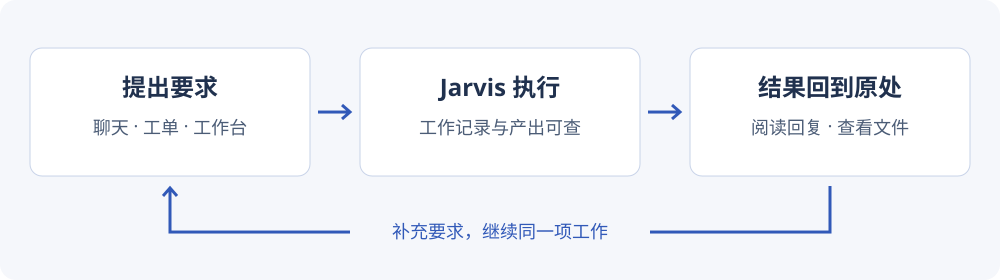

# Jarvis Box 可以怎样帮你

你可以在聊天、工作项或终端工作台提出要求，让 Jarvis 持续完成一项工作。本页用日常场景说明从哪里开始、怎么说、会看到什么；示例中的项目、时间和要求需要替换成你的实际内容。



开始前，管理员需要完成相应渠道的接入，并为运行 Jarvis 的账号配置工作所需的权限。已有机器人不代表所有平台资料都能读取；具体范围在各接入指南中说明。

| 你想做什么 | 从哪里开始 |
| --- | --- |
| 交办一件事，随后补充要求 | [在聊天里交办与继续](#在聊天里交办与继续) |
| 让 Jarvis 结合文件或讨论处理问题 | [带上材料，减少重复解释](#带上材料-减少重复解释) |
| 在工单或代码评审中直接处理 | [围绕原工作项推进](#围绕原工作项推进) |
| 等待 Actions，并在失败后继续处理 | [让外部结果回来找你](#让外部结果回来找你) |
| 本人换一个入口继续工作 | [换入口，继续自己的工作](#换入口-继续自己的工作) |
| 把固定工作设成例行任务 | [定时做重复工作](#定时做重复工作) |

## 在聊天里交办与继续

**适合：** 调查问题、整理资料、修改代码或生成报告，并在同一项工作里反复完善。

在已接入的机器人私聊中直接说；群里先提及机器人：

```text
@Jarvis 帮我检查这个项目的安装说明，找出新用户容易卡住的步骤并修改。
```

你会先收到简短的受理信息，随后在原会话收到回复。需要调整时，在同一会话接着说：

```text
再把首次安装和日常升级分开写，给每一步补上预期结果。
```

普通后续消息会接着当前工作。一个会话里有多项工作时，可发送 `@Jarvis 任务` 找到对应运行编号，再用 `@Jarvis 继续 r_… 新要求` 明确指定。运行编号用于找到对应工作。

[查看完整消息与任务用法](../integrations/im.md)。

## 带上材料，减少重复解释

**适合：** 分析截图、附件、被引用的消息，或结合群里近期讨论处理问题。

上传文件、引用消息，然后说明要做什么：

```text
@Jarvis 对照附件里的报错和这条讨论，检查为什么导出失败，并给出修复建议。
```

Jarvis 会把能够实际读取的材料用于这次工作。无法读取、引用缺失或内容超出限制时，会说明缺口；不会把一个诊断文件当成已经拿到了原文。

飞书可以在已配置权限范围内读取原生会话记录；企微、钉钉的背景和搜索范围是机器人实际收到且仍保留的消息。不要假定机器人已经看到了进群前或尚未收到的完整历史。

[查看附件、引用和历史范围](../integrations/im.md)。

## 围绕原工作项推进

**适合：** 工单调查、Issue 修复、PR/MR 评审，让要求与结果留在原对象中。

在管理员已接入、允许处理的工作项下评论，例如：

```text
@jarvis 先复现这个问题，确认原因后修复，并把验证结果写回来。
```

Jarvis 根据这个工作项执行，结果回写原处。后续在原对象继续提要求即可。不同系统的支持事件和默认范围不同，例如 Jira 的处理类型需要由管理员配置，不能仅凭上面一句话推断所有对象都已接入。

[了解工作项处理](provider-loop.md)，或按实际平台阅读 [GitHub](../integrations/github.md)、[GitLab](../integrations/gitlab.md)、[Jira](../integrations/jira.md) 等接入说明。

## 让外部结果回来找你

**适合：** Jarvis 已经提交代码，需要等待 GitHub Actions 结束；失败后希望继续处理。

在这项工作的原 IM 会话里发送：

```text
@Jarvis 订阅 当前
```

Jarvis 会确认能否识别这项工作对应的 Actions 运行。识别不明确时，需要提供具体运行链接；不会猜测整个分支的任意一次构建。

运行结束后会回到登记时的会话提醒。失败时，只有原任务仍满足继续条件才会接续；不能继续时会说明原因。可用 `@Jarvis 查看订阅` 查看，用 `@Jarvis 取消订阅 <返回的引用>` 停止后续动作。

这是一项针对具体 Actions 运行的一次性等待，不是所有平台的通用事件监控。[查看账号权限、Webhook 和订阅示例](../integrations/github.md)。

## 换入口，继续自己的工作

**适合：** 先在群里发起，之后由本人到机器人私聊继续；或在网页中查看与补充自己的工作。

先记下或从任务列表找到运行编号。在另一条已核验身份的机器人私聊中发送：

```text
@Jarvis 继续 r_… 再整理一版适合发给客户的说明。
```

系统能确认你是原工作创建者、当前入口允许继续时，会在这条私聊里继续并回复。运行编号本身不是访问许可；无法确认身份时会说明原因。换入口也不会把原群的历史读取权限带到私聊。

换入口续接适用于原创建者本人；已有群内协作继续在原群进行。网页入口的选择、历史和继续方式见 [终端工作台](../status-ui.md#终端工作台)。

## 定时做重复工作

**适合：** 每日巡检、固定周报和定期汇总，不希望每次记着手动交办。

先由负责你们 Jarvis 或 Runtime Foundation 的管理员配置主机定时计划。交给管理员的需求需要包含目标、时间、时区、数据来源和结果去向，例如：

```text
每个工作日北京时间 9 点汇总项目昨天的 Issue 变化，生成一份简报，发到已配置的通知会话。
```

管理员在客户自己的调度器中保存计划，到点通过任务接口交给 Jarvis Box 执行，并按配置投递结果。每次触发保留执行记录，失败后可以查看原因；关闭浏览器不会停止主机上的计划。要停止后续触发，由调度器的维护者停用或删除计划；停止某一次运行不会取消整个计划。

[查看计划格式、启用与排障](../scheduled-jobs.md)。

## 接下来

- 第一次部署：按 [安装与首次使用](getting-started.md) 完成一条真实工作的验证。
- 已经在用：查 [终端工作台](../status-ui.md) 或 [IM 使用说明](../integrations/im.md)。
- 负责运维：查 [日常维护](../operations.md) 与 [配置参考](../configuration.md)。
